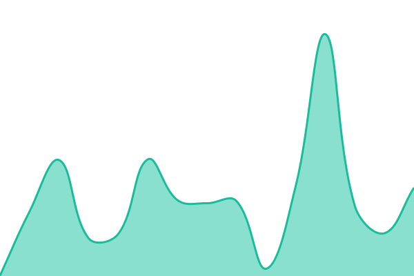
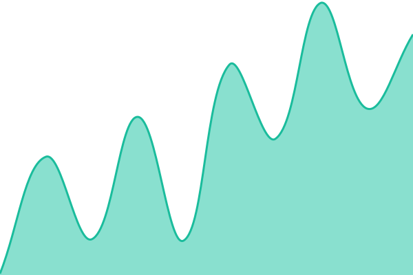
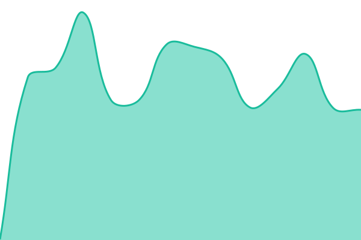
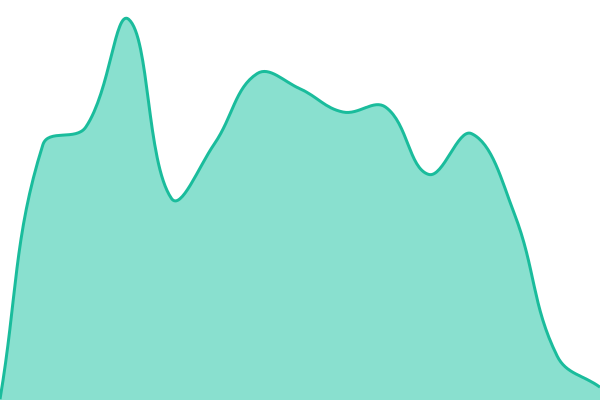
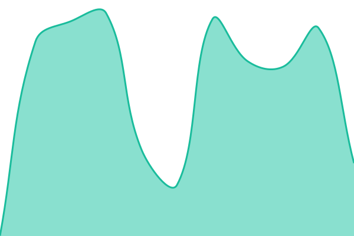

# XTermium status

Live at **https://status.xtermium.com**. Checked every five minutes by [Upptime](https://upptime.js.org) on GitHub Actions, off XTermium's own server. Health only: nothing about accounts, people or revenue. What is checked and why: [`.upptimerc.yml`](.upptimerc.yml).

## [Live status](https://status.xtermium.com): <!--live status--> **🟧 Partial outage**

<!--start: status pages-->
<!-- This summary is generated by Upptime (https://github.com/upptime/upptime) -->
<!-- Do not edit this manually, your changes will be overwritten -->
<!-- prettier-ignore -->
| URL | Status | History | Response Time | Uptime |
| --- | ------ | ------- | ------------- | ------ |
|  [Authentication · Sign-in service](https://account.xtermium.com/auth/ok) | 🟩 Up | [sign-in-service.yml](https://github.com/xtermium/upptime/commits/HEAD/history/sign-in-service.yml) | 

 614ms
     
 | 

<a href="https://status.xtermium.com/history/sign-in-service">100.00%</a>
    

|  [Authentication · Google](https://accounts.google.com/.well-known/openid-configuration) | 🟩 Up | [sign-in-with-google.yml](https://github.com/xtermium/upptime/commits/HEAD/history/sign-in-with-google.yml) | 

 59ms
     
 | 

<a href="https://status.xtermium.com/history/sign-in-with-google">100.00%</a>
    

|  [Authentication · GitHub](https://github.com/login) | 🟩 Up | [sign-in-with-git-hub.yml](https://github.com/xtermium/upptime/commits/HEAD/history/sign-in-with-git-hub.yml) | 

 233ms
     
 | 

<a href="https://status.xtermium.com/history/sign-in-with-git-hub">100.00%</a>
    

|  [Authentication · Discord](https://discord.com/api/v10/gateway) | 🟩 Up | [sign-in-with-discord.yml](https://github.com/xtermium/upptime/commits/HEAD/history/sign-in-with-discord.yml) | 

 65ms
     
 | 

<a href="https://status.xtermium.com/history/sign-in-with-discord">100.00%</a>
    

|  [Sync · Server](https://account.xtermium.com/healthz) | 🟩 Up | [sync-server.yml](https://github.com/xtermium/upptime/commits/HEAD/history/sync-server.yml) | 

 517ms
     
 | 

<a href="https://status.xtermium.com/history/sync-server">100.00%</a>
    

|  [Sync · Storage](https://account.xtermium.com/healthz) | 🟩 Up | [sync-storage.yml](https://github.com/xtermium/upptime/commits/HEAD/history/sync-storage.yml) | 

 445ms
     
 | 

<a href="https://status.xtermium.com/history/sync-storage">100.00%</a>
    

|  [Sync · Load](https://account.xtermium.com/healthz) | 🟩 Up | [sync-server-load.yml](https://github.com/xtermium/upptime/commits/HEAD/history/sync-server-load.yml) | 

 371ms
     
 | 

<a href="https://status.xtermium.com/history/sync-server-load">100.00%</a>
    

|  [Co-op · Relay](https://relay.xtermium.com/healthz) | 🟩 Up | [co-op-relay.yml](https://github.com/xtermium/upptime/commits/HEAD/history/co-op-relay.yml) | 

 711ms
     
 | 

<a href="https://status.xtermium.com/history/co-op-relay">100.00%</a>
    

|  [Co-op · Ring creation](https://account.xtermium.com/healthz/coop) | 🟩 Up | [co-op-ring-creation.yml](https://github.com/xtermium/upptime/commits/HEAD/history/co-op-ring-creation.yml) | 

 437ms
     
 | 

<a href="https://status.xtermium.com/history/co-op-ring-creation">100.00%</a>
    

|  [Releases · GitHub Actions](https://www.githubstatus.com/api/v2/components.json) | 🟩 Up | [git-hub-actions.yml](https://github.com/xtermium/upptime/commits/HEAD/history/git-hub-actions.yml) | 

 99ms
     
 | 

<a href="https://status.xtermium.com/history/git-hub-actions">100.00%</a>
    

|  [Releases · Nightly build](https://github.com/xtermium/xtermium/actions/workflows/nightly.yml/badge.svg) | 🟩 Up | [app-nightly-build.yml](https://github.com/xtermium/upptime/commits/HEAD/history/app-nightly-build.yml) | 

 268ms
     
 | 

<a href="https://status.xtermium.com/history/app-nightly-build">100.00%</a>
    

|  [Releases · Release build](https://github.com/xtermium/xtermium/actions/workflows/release.yml/badge.svg) | 🟩 Up | [app-release-build.yml](https://github.com/xtermium/upptime/commits/HEAD/history/app-release-build.yml) | 

 301ms
     
 | 

<a href="https://status.xtermium.com/history/app-release-build">100.00%</a>
    

|  [Releases · App build](https://github.com/xtermium/xtermium/actions/workflows/build.yml/badge.svg) | 🟥 Down | [app-build.yml](https://github.com/xtermium/upptime/commits/HEAD/history/app-build.yml) | 

 296ms
     
 | 

<a href="https://status.xtermium.com/history/app-build">99.76%</a>
    

|  [Packages · Scoop](https://github.com/xtermium/scoop/actions/workflows/excavator.yml/badge.svg) | 🟩 Up | [scoop-bucket-updates.yml](https://github.com/xtermium/upptime/commits/HEAD/history/scoop-bucket-updates.yml) | 

 325ms
     
 | 

<a href="https://status.xtermium.com/history/scoop-bucket-updates">100.00%</a>
    

|  [Packages · Homebrew](https://github.com/xtermium/homebrew-tap/actions/workflows/bump.yml/badge.svg) | 🟩 Up | [packages-homebrew.yml](https://github.com/xtermium/upptime/commits/HEAD/history/packages-homebrew.yml) | 

 184ms
     
 | 

<a href="https://status.xtermium.com/history/packages-homebrew">100.00%</a>
    

|  [Packages · AUR](https://github.com/xtermium/packages/actions/workflows/aur.yml/badge.svg) | 🟩 Up | [packages-aur.yml](https://github.com/xtermium/upptime/commits/HEAD/history/packages-aur.yml) | 

 173ms
     
 | 

<a href="https://status.xtermium.com/history/packages-aur">100.00%</a>
    

|  [Packages · winget](https://github.com/xtermium/packages/actions/workflows/winget.yml/badge.svg) | 🟩 Up | [packages-winget.yml](https://github.com/xtermium/upptime/commits/HEAD/history/packages-winget.yml) | 

 159ms
     
 | 

<a href="https://status.xtermium.com/history/packages-winget">100.00%</a>
    

|  [Packages · Chocolatey](https://github.com/xtermium/packages/actions/workflows/choco.yml/badge.svg) | 🟩 Up | [packages-chocolatey.yml](https://github.com/xtermium/upptime/commits/HEAD/history/packages-chocolatey.yml) | 

 159ms
     
 | 

<a href="https://status.xtermium.com/history/packages-chocolatey">100.00%</a>
    

|  [Payments · Creem](https://api.creem.io/) | 🟩 Up | [payments-creem.yml](https://github.com/xtermium/upptime/commits/HEAD/history/payments-creem.yml) | 

 503ms
     
 | 

<a href="https://status.xtermium.com/history/payments-creem">100.00%</a>
    

|  [Website · xtermium.com](https://xtermium.com/) | 🟩 Up | [website.yml](https://github.com/xtermium/upptime/commits/HEAD/history/website.yml) | 

 147ms
     
 | 

<a href="https://status.xtermium.com/history/website">100.00%</a>
    

<!--end: status pages-->

Planned work is announced as an issue from the "Maintenance Event" template.

Fonts in `fonts/` (Commissioner, JetBrains Mono) are under the SIL Open Font License 1.1, as on xtermium.com.
